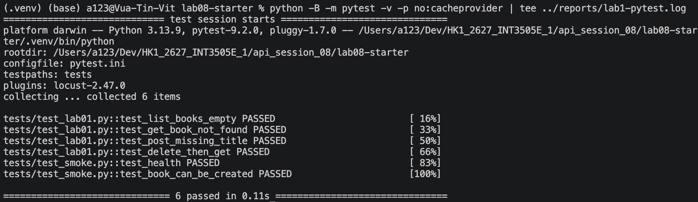
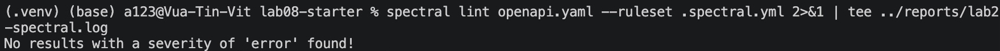
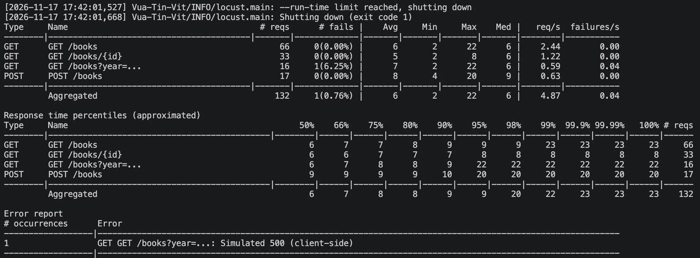
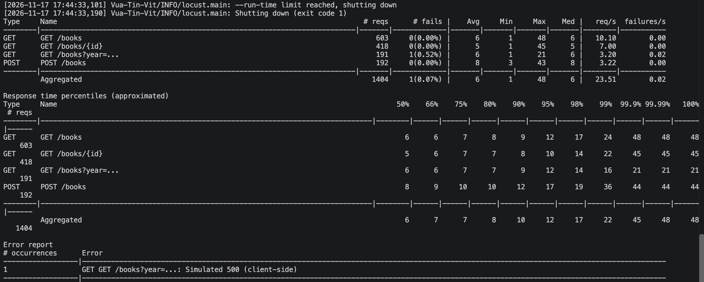

# B8 - API Testing và Quality Assurance
## Lab 1 - Kiểm thử Books API bằng pytest



## Lab 2 - Kiểm tra OpenAPI bằng Spectral
```text
No results with a severity of 'error' found!
```



## Lab 3 - Chạy collection bằng Newman

Mở hai Terminal tại thư mục `api_session_08/lab08-starter`.

**Terminal 1 - Chạy API:**

```bash
python -m app --port 5001
```

**Terminal 2 - Chạy Newman và xuất JUnit:**

```bash
newman run books-api.postman_collection.json \
  -e postman/local.postman_environment.json \
  --env-var base_url=http://127.0.0.1:5001 \
  -r cli,junit \
  --reporter-junit-export junit.xml
```

Báo cáo kết quả: [junit.xml](lab08-starter/junit.xml).


## Lab 4 - Load test Books API bằng Locust

### Kịch bản A - 10 users, spawn rate 2, 30s

```bash
locust -f performance/locustfile.py --headless \
  -H http://127.0.0.1:5001 \
  -u 10 -r 2 -t 30s \
  --html reports/A.html
```



[Báo cáo HTML A](lab08-starter/reports/A.html).

### Kịch bản B - 50 users, spawn rate 5, 60s

```bash
locust -f performance/locustfile.py --headless \
  -H http://127.0.0.1:5001 \
  -u 50 -r 5 -t 60s \
  --html reports/B.html
```



[Báo cáo HTML B](lab08-starter/reports/B.html).

### Kịch bản C - 200 users, spawn rate 50, 30s

```bash
locust -f performance/locustfile.py --headless \
  -H http://127.0.0.1:5001 \
  -u 200 -r 50 -t 30s \
  --html reports/C.html
```


[Báo cáo HTML C](lab08-starter/reports/C.html).

Các failure trong ba lượt chạy trên đều là `Simulated 500 (client-side)` do task đánh dấu giả lập trong Locust. Xác suất 1% áp dụng cho từng request tìm theo năm; tỉ lệ quan sát có thể khác 1%.
