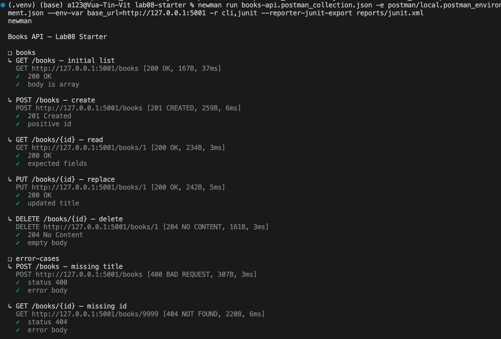
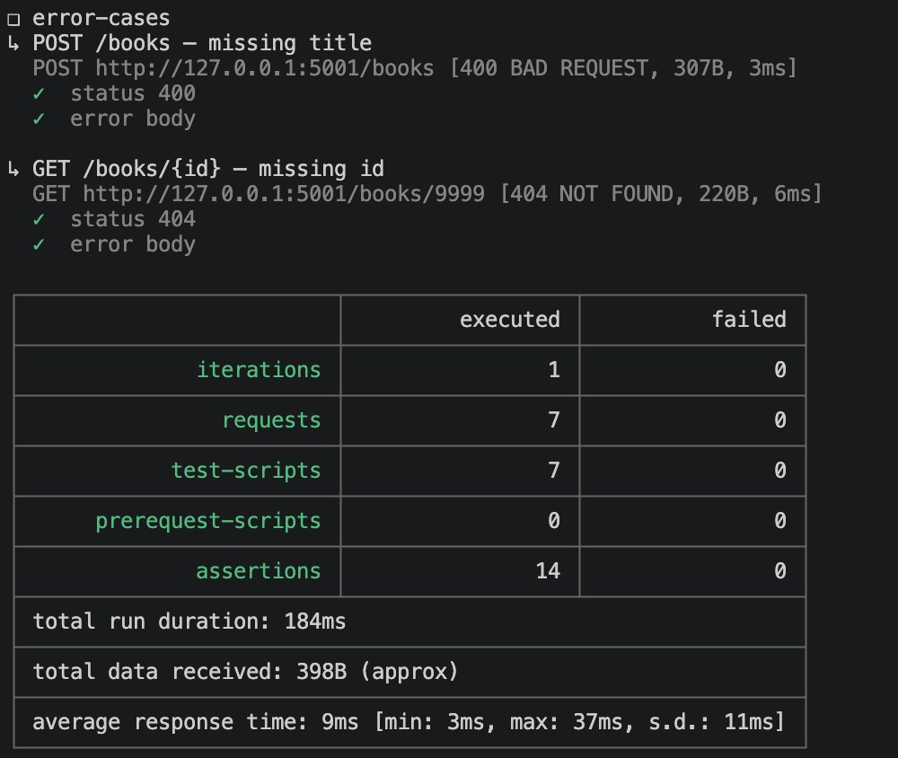

# B8 - API Testing và Quality Assurance
## Lab 1 - Kiểm thử Books API bằng pytest


## Lab 2 - Kiểm tra OpenAPI bằng Spectral
```text
No results with a severity of 'error' found!
```


## Lab 3 - Chạy collection bằng Newman



