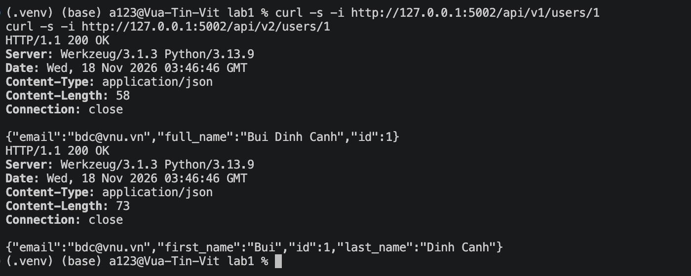
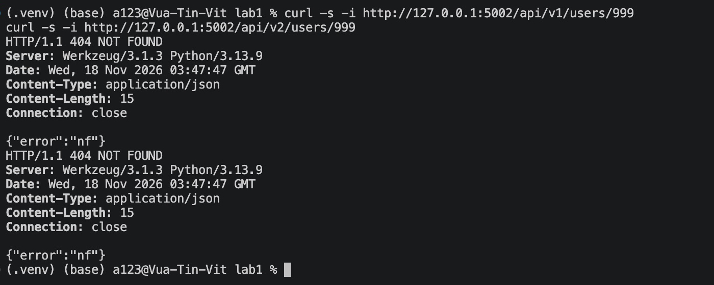

# Lab 1 B9 — URI Path Versioning với Flask Blueprint

## Kết quả

### User tồn tại — HTTP 200

Cùng user ID 1: v1 trả `full_name`, v2 trả `first_name` và `last_name`.

### User không tồn tại — HTTP 404

User ID 999: cả v1 và v2 trả HTTP 404 với body `{"error":"nf"}`.

